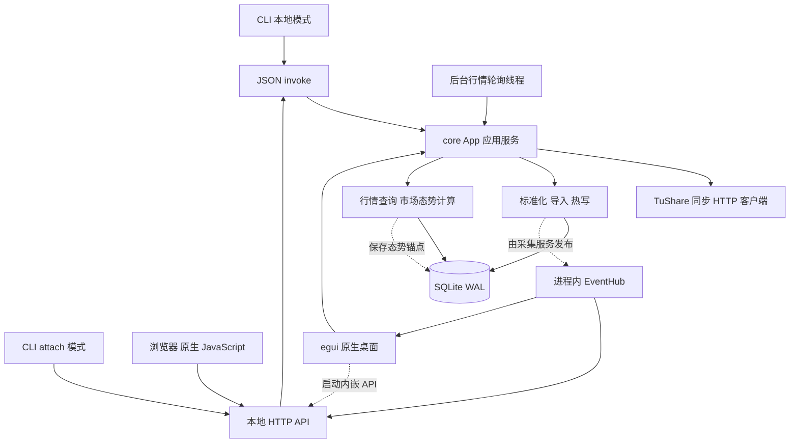
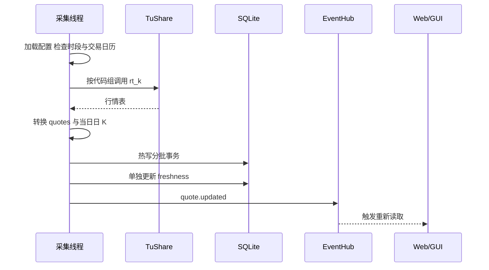
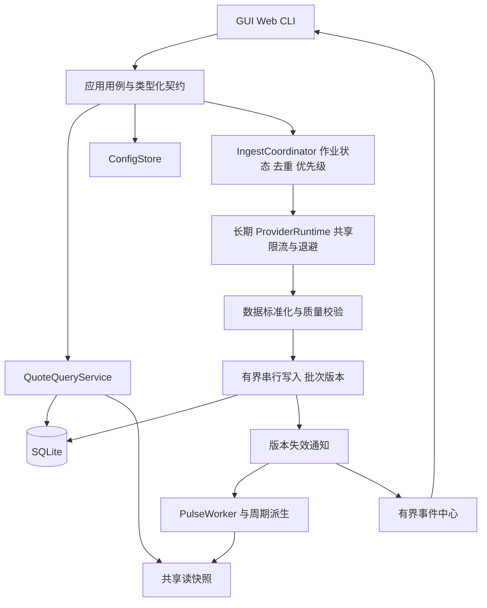

# GetRich 系统架构、功能与流程评估报告

评估日期：2026-09-22。角色：软件架构师。对象：当前工作区代码，基准提交 `d2aa769`，包含评估前已存在的大量未提交修改及新增文件。

本报告以源码与本地测试为依据，不把历史审查文档中的待办直接当作现存缺陷。结论中的“确认”指可由当前代码直接确认；并发故障、安全利用和性能影响未全部通过运行场景复现。未连接真实 TuShare 账户，未验证供应商权限、交易日实时响应或实际全市场容量。仅新增本报告，未修改业务代码。

## 1. 总体结论

项目已经形成一个可运行的、本地优先的股票行情工作台：Rust workspace 组织清楚，核心逻辑能被 CLI、HTTP/Web 和原生 GUI 复用；SQLite、导入、行情展示、实时轮询、市场态势已有实现。当前最适合定位为单用户桌面行情与分析基座。

主要问题集中在数据生命周期、进程与任务管理以及运行状态一致性，而不是语言或数据库选型。建议保留模块化单体和 SQLite，先收口写入、采集调度和配置管理。现阶段没有充分证据支持改微服务、引入消息中间件或更换数据库。

优先处理五类事项：

1. 本机 API 的来源校验和变更请求重复执行。
2. 盘中快照、收盘定稿以及周/月衍生数据的一致性。
3. 全局采集配额、重复任务和多进程所有权。
4. 配置持久化与内存状态原子更新。
5. GUI 阻塞、有界事件分发和可验证的发布质量。

现有测试通过说明已覆盖的基础行为稳定，但尚不能证明系统具备生产级并发、故障恢复和端到端正确性。

## 2. 当前架构与模块职责

| 模块 | 当前职责 | 评价 |
|---|---|---|
| `getrich-core` | 配置、路径、领域数据、SQLite、导入、TuShare、轮询、态势、应用服务和 invoke | 复用价值高，但领域规则、基础设施与应用编排仍集中在同一 crate |
| `getrich-api` | tiny_http 服务、路由、JSON envelope、内嵌静态资源、NDJSON 事件流 | 发布简单；请求线程、长连接、错误映射需要治理 |
| `getrich-cli` | clap 命令、JSON 输出、本地调用、attach 转发、serve | 适合自动化；本地模式会形成独立配置与事件状态 |
| `getrich-gui` | eframe/egui 桌面、行情/K 线、态势、数据和设置页面 | 直接复用核心；部分数据库操作仍在 UI 线程 |
| `web` | 单个 app.js 管理状态、路由、网络、渲染和图表 | 无前端构建负担；后续维护、竞态与双端一致性成本较高 |
| `packaging` / CI | Windows/Linux 打包脚本、Ubuntu 测试与 clippy | 已有基础自动化，但 Windows 发布与最低 Rust 版本未被 CI 矩阵覆盖 |

这是“多入口共享核心”的模块化单体，不是前后端完全分离的服务架构。GUI 直接调用 App，浏览器通过 HTTP/invoke；两者只有业务核心共享，交互状态和图表实现仍是两套。

### 值得保留的设计

- `(symbol, market)` 作为证券唯一键，避免跨市场同代码冲突。
- SQLite WAL、外键与唯一约束、事务迁移，适合本地应用。
- 报价乱序保护、跨日字段处理、空数据状态，以及缺少 listing 的自选占位。
- TuShare 数据映射集中，交易时间转换有专门模块和测试。
- 热行情写入不逐轮生成 ingest_runs，避免高频运行日志膨胀。
- 市场态势读取不访问外部网络，供应商故障不会直接阻断所有展示。
- 报告与错误 envelope 在多个入口复用，已有能力发现接口。

## 3. 功能范围与成熟度

| 功能 | 已实现能力 | 边界或缺口 |
|---|---|---|
| 行情列表 | 板块、搜索、行业、排序、分页参数、自选 | Web/GUI 当前常用加载量为 400；API 分页存在不代表 UI 已有完整翻页体验 |
| 个股详情 | 报价、资料、日/周/月 K 线、均线 | 缺数据可触发远程补齐；收盘定稿和衍生周期更新有一致性问题 |
| 数据导入 | JSON/CSV、bundle/listings/quotes/bars、幂等键、导入报告 | 整文件读取；CSV 解析手写；质量校验和失败分类不足 |
| TuShare 同步 | 股票列表、日线快照、个股历史、实时 rt_k | 当前自动行情主要面向 A 股；HK/US 建模支持不等于已实现对应实时数据源 |
| 自动刷新 | 时段判断、交易日历检查、指数退避、刷新事件 | 限流生命周期不正确；没有统一作业去重与持久化进度 |
| 市场态势 Pulse | 涨跌分布、行业强弱、估算极值、指数/风格输入、规则分类、阶段锚点 | 资金/新闻仍有 pending 占位；指数展示依赖库中有实际数据；不是回测或交易系统 |
| 配置与自选 | 默认配置合并、环境变量、自选保存、默认板块 | 静态配置、热加载 TuShare 配置和局部 Mutex 并存 |
| 运维 | 日志、health、stats、freshness、runs | 健康状态与故障映射不够准确；缺备份恢复、任务取消、指标体系 |

未在当前源码中发现完整的策略执行、回测、订单、持仓、风控或券商交易链路。后续若扩展，应单独定义这些领域，避免把交易职责塞进当前行情 App。

## 4. 关键业务流程分析

### 4.1 启动与运行所有权

CLI serve/API 启动配置与 App，执行迁移并提供服务。GUI 启动 App、采集线程和内嵌 API，然后进入 egui 循环。`ingest.started` 能阻止同一 App 重复启动，但不能防止两个独立进程同时采集。

GUI 在配置加载失败时使用默认配置；迁移和 API 启动失败主要写日志，界面仍可能运行。若另一个进程已占用端口，新 GUI 仍可能有自己的采集线程，而浏览器连到旧进程。两端虽然可共享数据库，却不共享自选内存、任务和事件。

优化：启动顺序统一为配置校验 → 获取数据目录实例锁 → 迁移 → 启动服务/worker → 展示 ready；已有实例时明确 attach 或提示。配置错误、数据库不可用和端口冲突应在界面可见。退出时取消 worker、关闭订阅、等待有界时间内完成任务。

### 4.2 文件导入

`apply_bundle_conn` 包裹一个事务，但行级错误被收集后继续处理，所以业务语义是“有效行提交、失败行记录、返回 partial”，并非“任意错误全部回滚”。应在导入契约明确这一点。事务级失败时，同事务内的运行记录也可能回滚，不能依赖 ingest_runs 覆盖所有失败。

建议先保留 partial 语义，增加 `accepted/changed/unchanged/stale/rejected` 计数和行号、错误类型；可选 strict 模式在预校验失败时拒绝整批。大文件采用分段解析与受控批次，明确批次边界和恢复策略。通用导入完成也应触发一致的状态失效通知。

### 4.3 实时采集

优点是网络抓取离开界面线程。主要风险是客户端每轮重建、某代码组失败会使当前轮已收集结果不进入最终写入、报价/K 线/水位分开提交，以及热写仅接受已存在 listing。

应先建立主数据就绪状态，再开始全市场轮询；失败代码组独立记录并补偿。写入批次附带 snapshot_version，事件携带提交版本。水位只代表实际接纳的数据，并区分请求成功、有效数据成功、完整覆盖成功。

### 4.4 详情展示与补齐

Web `loadDetail` 对 A 股先等待 `tushare.quote`，然后读取本地详情和 K 线；不足 40 条时再拉取历史。此顺序使已经存在的本地数据也可能等待网络超时。GUI 已把部分远程抓取放入后台，但列表、详情和 Pulse 仍有同步数据库调用。

建议立即展示本地快照及 as_of，再异步提交补齐任务；以证券键、周期和范围去重。结果必须校验当前选中证券与请求代数。切换股票取消无用的前端读取；后端任务独立决定是否继续，不能把浏览器取消误认为供应商请求已取消。

### 4.5 市场态势

当前为交易阶段判断 → 全市场扫描 → 样本分类 → 广度/成交额/行业聚合 → regime 规则 → headline → 持久化阶段锚点。

它不访问网络，但并非纯读：`compute_from_rows` 会保存锚点。当前锚点生成依赖页面/API 有没有请求，且多个调用会重复扫描。建议后台按数据版本和阶段计算共享快照，独立调度锚点落库；API 与 GUI 只读快照。没有打开页面时，也应得到相同的阶段历史。

## 5. 数据模型与一致性

主要表：`listings` 为证券主数据；`quotes` 每证券一行最新报价；`bars` 以证券、周期、时间唯一；`instrument_metadata` 为键值资料；`ingest_runs` 为导入运行；`data_freshness` 为数据水位；`pulse_anchors` 和 `pulse_vendor` 为态势历史及外部缓存。

该模型支持本地行情，但缺少明确的数据版本和终态：

- `source` 同时承担供应商、接口、实时/日线优先级，字符串包含关系已参与覆盖规则。
- 日线日期与实时时间共用时间语义；HK/US 后续不能直接继承全局上海交易日规则。
- `quotes` 只存最后值，不能用于逐笔/分钟历史回放；这是范围限制，并非当前必然缺陷。
- bar 没有 `is_final`、快照观察时间和修订号；同一日实时 bar 乱序覆盖难以识别。
- 复权仅有 `adj_close`，不足以表达前复权/后复权 OHLC 与公司行动版本。
- 水位依附虚拟 internal listing，迫使各查询记得排除内部证券。

建议分阶段增加 `trade_date`、`observed_at`、`ingested_at`、`source_kind`、`is_final`、`revision`，并明确定义成交量/金额单位、缺失值和复权口径。展示分析可继续使用 f64；若增加成交与资金结算，再为金额和数量定义精确十进制或定点模型。

## 6. 关键问题、方案与验收

优先级定义：P1 为下次稳定发布前处理；P2 为后续可靠性与容量迭代；P3 为长期演进。这里不把所有风险都提升为阻断项。

### A01 · P1 · API 来源校验可被前缀相似域名通过

**依据：** `crates/getrich-api/src/http.rs:354` 的 `loopback_origin` 使用 `starts_with("http://localhost")` 等判断。`http://localhost.evil.example` 等字符串也符合条件；POST 防护和 CORS 回显复用该结果。未看到 Host 严格校验。

**影响：** 允许来源集合超出本机页面；在浏览器允许请求抵达本机服务的前提下，非预期网页可能调用写接口。尚未进行真实浏览器利用验证。

**方案：** 结构化解析 Origin，精确匹配 scheme/host/port，默认仅允许服务实际 origin；Host 单独校验。原生 CLI 无 Origin 的调用定义清晰的本地客户端政策；如需本机会话凭证，由启动流程自动接线。

**验收：** 同源读写通过；相似前缀域名、`null`、畸形 Origin 和非允许 Host 被拒绝；IPv4、IPv6、显式端口均有测试。

### A02 · P1 · 自动重试变更请求，toggle 可能被执行两次

**依据：** `web/app.js:76` 的 `fetchJson` 对超时、网络错误、5xx 统一重试；`invoke` 的 POST 同样使用它。`watch.toggle` 是非幂等命令。

**触发：** 服务端已完成自选切换，但响应丢失，浏览器重试后又切回。同步任务也可能重复启动。

**方案：** GET 可重试；写请求显式声明重试策略。将 toggle 改为 `watch.set(watched=true/false)`，长任务使用请求幂等键与 job_id。

**验收：** 模拟“提交成功、响应丢失”，重放请求只产生一次预期状态变化。

### A03 · P1 · 限流器和客户端退避不能跨轮次共享

**依据：** `service.rs:164` 每次构造 Client；`ingest.rs:162` 每轮调用；`tushare.rs` 中 TokenBucket 与 Backoff 属于 Client 实例。

**影响：** 单实例窗口测试通过不等于全应用请求受控。轮询、详情、同步分别有新的配额，实际总请求可能超过配置；worker 自身虽有错误退避，但无法统一约束其它入口。

**方案：** App 持有长期 ProviderRuntime，统一客户端、配额和退避；任务按实时、自选、历史补齐设优先级。多进程通过单实例/attach 统一入口。

**验收：** 注入假时钟和供应商，在轮询与详情并发情况下，任意 60 秒窗口不超过配置的聚合额度；配置变更不无条件清空窗口。

### A04 · P1 · 实时保护缺少收盘定稿路径

**依据：** `db/bars.rs:34` 起的 SQL 永远保留已有 rt_k 数据而拒绝 daily 字段覆盖；`db/quotes.rs:7` 同日 EOD 对 live 直接返回成功，不判断收盘定稿。

**触发：** 最后一条实时行情停在 14:50；收盘后或次日导入正式日线，该日 K 线仍保留 14:50 快照。实时 bar 之间也没有观察时间防乱序字段。

**方案：** 明确 provisional → final → revised 状态；盘中保护实时数据，确认收盘后的正式数据可定稿，迟到快照不能覆盖 final。不要仅按来源字符串永久排序。

**验收：** 同日盘中 daily 不覆盖实时价；盘后正式 OHLCV 能定稿；迟到 rt_k 不回退；同日实时乱序不回退；后续修订有版本依据。

### A05 · P1 · 已存周/月线可能长期陈旧

**依据：** `tushare.rs:579` 的 `bars_bundle` 合成并存储周/月线；`service.rs:515` 附近只有目标周期完全为空才从日线重采样。实时更新只写日线。

**影响：** 一旦存在周/月历史，其本周、本月数据可能不随新日线变化。

**方案：** 当前规模优先统一从权威日线派生；若保留物化周/月线，日线修改必须按受影响周期失效重算。范围查询需要先扩展到完整周期再聚合，避免把半周当完整周。

**验收：** 修改任一日 K 后，相关周/月 OHLCV 同步更新，跨年周、月边界、范围过滤均正确。

### A06 · P1 · 配置并发覆盖与写失败状态不一致

**依据：** `service.rs:610` 在持久化前释放自选 Mutex；失败时把旧快照整体恢复。`set_default_board:652` 先更新内存，再写盘。`write_config:676` 从启动配置复制全量并直接覆盖文件。

**影响：** 并发变更可能乱序写盘；失败回滚可能覆盖另一次成功变更；手动改过的 TuShare 配置可能被旧启动快照覆盖；写中断可能留下损坏 JSON。

**方案：** 单一 ConfigStore 串行化读取—修改—持久化—发布；只更新目标字段，使用版本号。写临时文件后可靠替换，持久化成功才发布内存版本。跨进程由实例锁或文件锁协调。

**验收：** 两次并发不同自选变更均保留；模拟写盘失败时内存/文件仍一致；改自选不覆盖其它配置，也不把环境变量密钥落盘。

### A07 · P1 · 热写成功和新鲜度统计不代表真实有效更新

**依据：** `import.rs:248` 对 `upsert_quote` 返回 Ok 就累计，即使底层因旧数据而跳过；解析失败与 listing 缺失都计为 skipped_missing。`ingest.rs:223` 不判断有效写入量即标记 quotes 与 bars.1d 成功。

**影响：** 空库收到全量行情但所有证券缺 listing，仍可能显示最近成功；仅成功写 quotes 也可能更新 bars 水位；重复旧数据可被解释为有效更新。

**方案：** upsert 返回显式结果；按数据集分别统计接纳、变化、过期、拒绝和缺主数据。成功条件结合接纳数据、水位及覆盖率；无有效数据为 empty/partial，而非完整成功。

**验收：** 全部缺 listing、全部坏时间戳、全部过期、仅 quotes 四类输入不会产生虚假 bars 成功；客户端显示覆盖不足原因。

### A08 · P2 · UI 线程可能等待数据库锁与重试

**依据：** GUI `app.rs:174` 同步查询行情；`:527` 每 3 秒同步调用 market_pulse；数据库 busy_timeout 为 5 秒，App 还可重试。

**方案：** 所有可能阻塞的查询移入受控后台执行器，界面只渲染最后成功快照；请求去重、结果代数校验、错误状态保留。Pulse 用共享缓存。

**验收：** 人为持有数据库写锁时，窗口仍能滚动、切页和响应输入。不能只测空库帧率。

### A09 · P2 · 请求线程与事件队列无界

**依据：** HTTP 每请求创建线程（`http.rs:42`）；事件连接长期占用线程；`events.rs:34` 使用 unbounded。

**方案：** 设置普通请求与长连接的独立上限、超时和拒绝策略；事件使用有界队列。报价通知适合合并为“最新版本”，慢客户端丢中间通知后重新取快照；需要审计语义的任务终态另行保存。先用有界同步执行器即可，不必先整体迁移异步框架。

**验收：** 慢读客户端、断线重连和连接上限场景下，线程与内存保持上界；普通查询不会被全部长连接挤占。

### A10 · P2 · Pulse 计算、锚点和新鲜度耦合

**依据：** `pulse/mod.rs:279` 起的查询路径扫描后保存锚点；stale 主要根据全样本最大 ingested_at，单只新数据可能掩盖其余样本陈旧。交易日历读取未同时核验缓存适用日期。

**方案：** 后台按批次计算，读端无写副作用；定义当日有效样本比例、更新覆盖率和时间分位数，不能只用最大时间；交易日历标记 valid_for/fetched_at，过期时显式 unknown。

**验收：** 大部分行情陈旧、仅一只刚更新时，不能显示全市场新鲜；关闭所有界面仍生成阶段快照；旧日历不静默判定新交易日休市。

### A11 · P2 · 输入、错误与能力契约不一致

**依据：** HTTP 非 NotFound 错误大部分返回 400；health 将 stats 错误吞为 None 仍返回 200。read_body 按 body_length 分配，未知长度按 0，超限截断但不明确 413。capabilities 宣告 since_seq，事件处理不实现回放；实际部分路由未列出，bind 写死。

**方案：** 强类型请求参数和范围校验；400/404/409/413/429/500/503 分别映射；liveness 与 readiness 分离；流式读入至上限加一判定超限；统一路由与能力注册。对 since_seq 选择实现版本恢复或删除承诺。

**验收：** 非法 JSON、分块 body、超限 body、数据库不可用、未知 board、真实 bind 与断线恢复均有 HTTP 契约测试。

### A12 · P2 · 数据校验、迁移与发布恢复不足

**依据：** `models.rs:258` 只校验 OHLC 有限及 high≥low，未要求 high≥open/close、low≤open/close；无效 bar 被静默跳过。迁移 `user_version >= 当前版本` 即跳过，包括高于支持版本。Windows 打包复用 dist，保留已有 config.json。

**方案：** 完整数据不变量与拒绝原因；启动验证迁移账本及版本范围，拒绝不支持的未来 schema；迁移前备份与恢复演练。发布用新 staging 目录和明确文件白名单，不能把含历史私人配置的 dist 直接压缩发布。

**验收：** 非法 OHLC 有明确拒绝计数；高版本库拒绝启动；中断迁移可恢复；发布清单不含真实用户配置、数据库或日志。

## 7. 性能与容量优化

以下为源码可见的潜在成本，尚未压测，不能据此宣称目前已达到瓶颈。

| 路径 | 当前成本 | 优化顺序 |
|---|---|---|
| 列表读取 | 每次开连接、总量统计、列表 SQL、matched 统计 | 先测查询耗时；统计按数据版本缓存；连接按执行器复用 |
| 实时热写 | 每轮构建完整 listing-id 映射、逐条 upsert、分组写入 | 缓存证券映射并在主数据变更后失效；批内复用 prepared statement |
| Pulse | 多调用者全市场扫描、Rust 聚合、历史金额查询 | 先后台单次计算与快照缓存；再按 profile 下推适合的 SQL 聚合 |
| 大历史库 | 全局 bars COUNT 和按交易日历史金额聚合可能增长 | EXPLAIN QUERY PLAN 加基准后决定索引和日级汇总表 |
| 事件刷新 | 每次通知可能触发列表、详情、K 线重复读取 | 通知节流与合并；按数据版本避免重复计算 |
| 大自选列表 | service 申请 10000，但 DB 最大返回 2000 | 自选专门查询、正确排序与分页；不得把超限的已有报价变成占位行 |

现有 UNIQUE(instrument_id,timeframe,ts) 与 idx_bars_lookup 列相同，可能存在冗余索引写入成本；先检查实际索引与查询计划再决定删除。不要机械地为每个过滤字段加索引。

建议基准数据：约 6000 只证券、每只 1250 个交易日日线（约 750 万 bar）；额外准备稀疏数据、乱序批次和大型自选。使用独立测试库，记录机器、构建模式、冷/热缓存、写入并发和样本分布。

建议初始验收目标（目标值，非实测结果）：400 行列表暖缓存 P95≤200ms；Pulse 快照读取 P95≤100ms；单轮 6000 行写入与计算总耗时小于配置轮询周期；GUI 在锁等待场景仍可交互；事件慢消费者内存不持续增长。真实供应商时延单列，避免混入本地查询指标。

## 8. 推荐目标架构

职责拆分优先在 core 内以模块进行，不急于增加 crate：

- `domain`：证券、交易日、数据质量、定稿规则、态势纯计算。
- `application`：导入、行情读取、自选设置、作业编排。
- `infrastructure`：SQLite、TuShare、配置文件、时钟、事件传输。
- `contracts`：类型化请求/响应及版本，适配 HTTP/CLI/GUI。

关键抽象只围绕真实替换与测试需求设置：Provider、Clock、ConfigStore、行情仓储接口。避免每张表都包装一个没有业务价值的通用 Repository。

建议作业状态：queued → running → succeeded / partial / failed / cancelled；记录请求键、数据范围、进度、错误、重试次数和时间。先做进程内队列加 SQLite 状态；是否恢复未完成作业由任务幂等性决定。

持久化的一致性目标：quotes、相关当日日 K 和数据集水位至少在逻辑批次上可追踪；事件在提交成功后发出。大批次允许分段提交，但暴露覆盖与版本，不能伪装成全市场瞬时原子截面。真正需要可靠事件交付时再加入事务 outbox。

## 9. 实施路线与工作量

下列为一名熟悉 Rust 的开发者的初步人日估计，包含针对性测试，不包含新供应商接入和实际账户等待；阶段可能重叠，需在设计细化后调整。

| 阶段 | 交付 | 预估 | 完成标准 |
|---|---|---|---|
| 第一阶段：正确性修复 | A01–A07；确立定稿与水位口径 | 7–12 人日 | 安全边界、幂等请求、行情定稿、周月一致性、并发配置测试通过 |
| 第二阶段：运行治理 | 单实例/attach、ProviderRuntime、作业去重、有界事件、GUI 后台查询 | 8–14 人日 | 多窗口与慢网络不重复采集；UI 不因数据库锁冻结；资源有界 |
| 第三阶段：读模型与恢复 | Pulse 后台化、快照缓存、查询基准、迁移备份、质量报告 | 6–10 人日 | 压测有基线、快照可解释、迁移恢复演练通过 |
| 第四阶段：工程收口 | 契约生成、双端组件拆分、CI 矩阵、文档与发布清单 | 4–7 人日 | Windows/最低版本/稳定工具链检查通过，文档与能力表一致 |

依赖顺序：先定义行情定稿/质量模型，再改仓储与聚合；先统一实例和 ProviderRuntime，再验证全局限流；先确定事件版本语义，再实现断线恢复。可按独立问题形成小 PR，避免一次同时重写数据库、服务层和 UI。

若只有一个迭代预算，优先修 A01/A02/A03/A04/A06，并补齐 A05/A07 的数据正确性回归；不要先投入换 UI 框架或微服务化。

## 10. 验证结果与测试补强

本次实际执行：

| 检查 | 结果 |
|---|---|
| `cargo test --workspace --offline` | 通过；core 71 项、API 1 项，共 72 项；CLI/GUI 当前测试目标为 0 项 |
| `cargo clippy -p getrich-core --offline -- -D warnings` | 失败，15 处 lint 诊断，涉及可派生 Default、参数过多、ptr_arg、filter_next 等；这是严格 lint 门禁失败，不是 workspace 测试编译失败 |
| CI 配置检查 | 已有 Ubuntu stable 的 workspace test/clippy；clippy 未设置 warnings-as-errors；未见 Windows/MSRV 矩阵 |
| 真实账户、浏览器端到端、交易时段和容量压测 | 本次未执行 |

建议补强：

1. 领域回归：盘中→收盘→修订、报价与 bar 乱序、日周月一致性、非法 OHLC、交易日历过期。
2. 并发与故障注入：共享限流、配置交错、持久化失败、写锁等待、供应商部分失败、退出取消。
3. HTTP 契约：Origin/Host、body 边界、错误码、health readiness、能力与路由一致。
4. Web/GUI 场景：快速切股、无网读缓存、写请求响应丢失、事件重连、相同夹具下双端数值一致。
5. 数据恢复：旧版本迁移、中断恢复、未来版本拒绝、备份恢复后的行数/校验和/关键查询一致。

## 11. 与已有审查文档的关系

`docs/CODE_REVIEW.md` 已指出不少相同方向。当前代码与测试显示，报价同日保护、北证代码解析、环境变量 token 不落盘、默认板块内存更新、自选基本分页、节假日保护、Open 锚点替换、CLI 较长 POST 超时等已有落实，不能重复记为完全未修。

但部分修复只解决局部：报价保护带来了缺少收盘定稿的问题；默认板块更新缺少持久化失败回滚；CORS 去掉通配符后仍有前缀白名单缺陷；请求代数降低了错股显示风险，但不能替代取消、去重和幂等。历史勾选项应以当前回归用例验证后关闭。

建议为架构决定补充 ADR：运行实例所有权、行情定稿策略、周月派生来源、配置持久化、事件恢复语义。每项记录目标、不变量、兼容迁移和验收，方便后续功能在一致规则下扩展。

## 12. 架构验收清单

- 同一数据目录只有一个采集与配置写入所有者，其他入口明确 attach。
- 供应商请求共享预算，重复任务可识别，失败和部分成功可观察。
- 盘中、收盘与修订数据有明确优先级，日/周/月数值一致。
- 自选和配置在并发、写失败及重启后保持一致。
- 本地 API 精确验证来源，写命令具备可证明的幂等语义。
- 数据错误不会被描述为全量新鲜，Pulse 能说明样本范围与陈旧比例。
- 查询和长任务不会阻塞 GUI；线程、队列和订阅数量有上界。
- 迁移、备份、发布和最低工具链经过自动化验证。

完成这些条件后，项目才有稳固基础继续扩展更多行情源、分析指标和策略研究模块。
