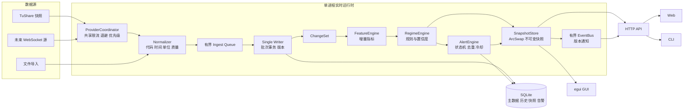
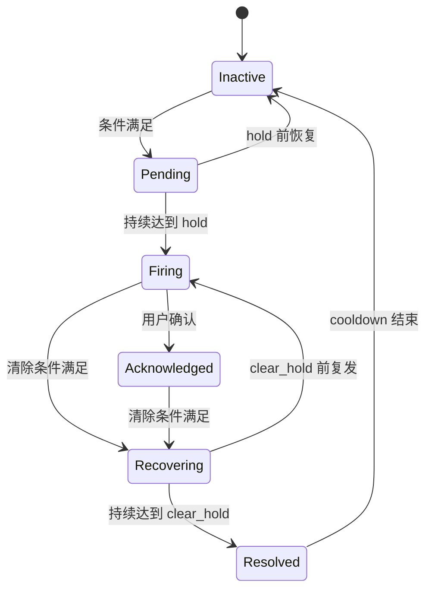

# GetRich 高性能市场态势实时分析与监控方案

版本：1.0

日期：2026-09-23

状态：技术评审通过；阶段 0 与阶段 1 基础链路已开始落地

实施记录（2026-09-23）：已加入 004 迁移、可追踪的行情批次版本与结果分类、后台共享 Pulse 快照、快照恢复、有界事件订阅及 256 条有限回放，并开放 `/v2/pulse`、`/v2/pulse/summary` 和 `/v2/system/realtime`。当前快照计算仍采用可靠的全量路径；增量 FeatureEngine、正式数据终态字段、告警状态机和界面切换按后续阶段推进。

## 1. 目标与边界

本方案在现有 Rust、SQLite、TuShare、本地 HTTP、Web 和 egui GUI 基础上建设一套高性能、可解释、可监控的 A 股市场态势系统。它实时接收行情快照，增量计算全市场、指数、行业、自选和异常事件，生成一致的不可变快照，并向 Web、GUI 和 CLI 推送更新。

核心目标：

- 覆盖约 6,000 只 A 股证券和主要指数。
- 行情批次提交后 300ms 内完成指标更新与事件发布；这是本地处理目标，不包含供应商网络耗时。
- 快照 API 在内存命中时 P95 小于 20ms，P99 小于 50ms。
- 正常交易时段连续运行，慢客户端、网络抖动和 SQLite 写锁不会拖垮采集链路。
- 每个结论均带数据时间、覆盖率、质量、置信度和解释依据。
- 告警可去重、抑制、确认、恢复，并保留审计记录。
- 无界面运行也会持续生成关键阶段快照与告警。

“实时”首先取决于数据源。TuShare `rt_k` 是轮询快照，本方案可将本地处理压到亚秒级，但不能把 5 秒轮询伪装成逐笔行情。响应中必须同时显示 `source_at`、`received_at`、`computed_at` 和 `source_lag_ms`。

第一阶段不包含自动交易、订单、持仓、逐笔回放、机器学习预测和多租户云服务。若未来接入 WebSocket/逐笔源，只替换 Provider Adapter，后续计算与展示契约保持稳定。

## 2. 当前能力复用与必须改造项

可直接复用：证券主键、交易时段模块、TuShare 映射、quotes/bars、行业字段、Pulse 规则与文案、SQLite WAL、Web/GUI 态势页面和事件连接。

必须先改造：

1. TuShare Client 必须成为 App 内长期共享实例，使限流和退避覆盖轮询、详情和手工同步。
2. Pulse 计算必须从请求路径移到后台计算引擎，API/GUI 只读最新快照。
3. 行情写入结果必须区分 accepted、changed、unchanged、stale、invalid 和 missing_listing。
4. 报价、日 K、水位和发布版本必须形成可追踪的逻辑批次。
5. EventHub 改为有界、可合并的版本通知；不能为每个慢订阅者无限积压消息。
6. GUI 所有数据库读取和分析计算离开 UI 线程。
7. 明确实时快照、收盘正式数据和后续修订的覆盖规则。

## 3. 非功能指标与容量预算

以下是建设目标，需要用固定数据集和硬件基准验证，不代表当前代码实测值。

| 指标 | 目标 |
|---|---:|
| 证券规模 | 6,000，设计余量 10,000 |
| 单批行情 | 6,000 quotes + 可选当日 bars |
| 供应商轮询 | 默认 5s，可配 2–30s，受实际配额限制 |
| 采集到数据库提交 P95 | ≤ 200ms，不含供应商网络 |
| 提交到 Pulse 快照 P95 | ≤ 100ms |
| 提交到客户端通知 P95 | ≤ 300ms |
| 内存快照 API P95/P99 | ≤ 20ms / 50ms |
| 历史趋势 API P95 | ≤ 150ms，24 小时窗口 |
| GUI 主线程单帧工作 | ≤ 8ms，60Hz 目标 |
| 数据覆盖率 | 正常盘中 ≥ 95%，低于阈值降级 |
| 内部有界队列 | 默认 8 个行情批次，满时合并到最新版本 |
| 可用性 | 单机交易时段 ≥ 99.9%，不承诺外部供应商可用性 |
| 恢复 | 进程重启 10s 内可读最近落盘快照，恢复后自动追新 |

内存预算建议控制在 256MB 内：最新行情、证券维度状态、行业聚合、60 分钟降采样趋势以及两份并行不可变快照。日线历史继续留在 SQLite，不复制到实时引擎。

## 4. 目标架构



### 4.1 设计原则

- 单写入者：所有实时写入由一个 writer 串行执行，减少 SQLite 锁竞争并形成清晰的批次边界。
- 增量计算：只对 ChangeSet 中变化的证券更新聚合；全量重算作为启动校验和故障恢复路径。
- 不可变快照：计算完成后一次原子交换，消费者看见旧版或新版，不看见半成品。
- 快路径与历史路径分离：实时页面读内存；历史趋势、审计和恢复读 SQLite。
- 最新值通知：行情事件允许合并，只保证客户端最终获知最新 snapshot_version；告警状态转换必须持久化。
- 质量优先：样本不足、时间陈旧、板块缺失或指数缺失时降低置信度，不生成过度确定的结论。

### 4.2 并发模型

建议先使用标准线程和 `crossbeam-channel`，不必为此全面迁移 Tokio：

| 执行单元 | 数量 | 职责 |
|---|---:|---|
| ProviderCoordinator | 1 | 调度外部请求，共享配额和退避 |
| Normalizer | 1–2 | 解析和校验供应商结果 |
| SQLite Writer | 1 | 分批事务、版本、水位、变更集 |
| Pulse Worker | 1 | 消费已提交 ChangeSet，增量计算并发布 |
| Snapshot Persistence | 1 | 低优先级落盘历史快照 |
| HTTP 普通请求池 | 固定 4–8 | 读取快照和历史查询 |
| 事件连接池 | 独立有上限 | 推送版本与告警 |

所有队列有界。行情队列满时保留每只证券最新 observation，并记录 `coalesced_batches`；告警队列满不能静默丢弃，必须同步持久化后再通知。

## 5. 数据契约

### 5.1 标准行情观察值

```rust
struct QuoteObservation {
    instrument_id: i64,
    trade_date: NaiveDate,
    source_at: DateTime<Utc>,
    received_at: DateTime<Utc>,
    last: f64,
    prev_close: Option<f64>,
    open: Option<f64>,
    high: Option<f64>,
    low: Option<f64>,
    volume: Option<f64>,      // 股
    turnover: Option<f64>,    // 元
    source: SourceId,
    source_kind: SourceKind,  // realtime | eod | revision
    quality: QualityFlags,
}
```

接纳顺序不能再依赖 `source.contains("rt_k")`。同一交易日使用 `(finality, source_at, revision)`：

```text
provisional realtime < official eod < official revision
```

盘中 EOD 预览不能覆盖更新的 realtime；确认收盘后的 official EOD 可以定稿当日 OHLCV；迟到 realtime 不能覆盖 final；revision 可以修订 final 并增加 revision。

### 5.2 批次与变更集

每次写入生成单调递增 `batch_version`：

```rust
struct CommittedBatch {
    version: u64,
    source: SourceId,
    requested: u32,
    accepted: u32,
    changed: u32,
    unchanged: u32,
    stale: u32,
    invalid: u32,
    missing_listing: u32,
    min_source_at: Option<DateTime<Utc>>,
    max_source_at: Option<DateTime<Utc>>,
    changed_ids: Vec<i64>,
    committed_at: DateTime<Utc>,
}
```

changed_ids 只在进程内传递；数据库保存批次统计。若 changed_ids 很大，使用排序后的 `Vec<i64>` 即可，6,000 个 i64 成本很低。Pulse Worker 若发现版本跳跃或启动恢复，执行全量重建。

### 5.3 不可变市场快照

```rust
struct MarketSnapshot {
    schema_version: u32,
    snapshot_version: u64,
    trade_date: NaiveDate,
    phase: SessionPhase,
    source_at: Option<DateTime<Utc>>,
    computed_at: DateTime<Utc>,
    quality: SnapshotQuality,
    regime: RegimeView,
    breadth: BreadthView,
    liquidity: LiquidityView,
    indices: Arc<[IndexView]>,
    sectors: Arc<[SectorView]>,
    styles: Arc<[StyleView]>,
    extremes: ExtremesView,
    watchlists: Arc<[WatchlistView]>,
    alerts: Arc<[AlertView]>,
}
```

用 `ArcSwap<MarketSnapshot>` 发布，API 和 GUI 通过 clone Arc 无锁读取。若暂不引入 `arc-swap`，可先用 `RwLock<Arc<MarketSnapshot>>`，临界区只做指针交换，禁止在锁内计算或序列化。

### 5.4 SQLite 迁移建议

新增迁移 `004_realtime_pulse.sql`：

```sql
CREATE TABLE ingest_batches (
  version INTEGER PRIMARY KEY AUTOINCREMENT,
  source TEXT NOT NULL,
  requested INTEGER NOT NULL,
  accepted INTEGER NOT NULL,
  changed INTEGER NOT NULL,
  unchanged INTEGER NOT NULL,
  stale INTEGER NOT NULL,
  invalid INTEGER NOT NULL,
  missing_listing INTEGER NOT NULL,
  min_source_at TEXT,
  max_source_at TEXT,
  committed_at TEXT NOT NULL,
  detail_json TEXT
);

CREATE TABLE pulse_snapshots (
  trade_date TEXT NOT NULL,
  snapshot_version INTEGER NOT NULL,
  phase TEXT NOT NULL,
  source_at TEXT,
  computed_at TEXT NOT NULL,
  quality TEXT NOT NULL,
  regime_code TEXT NOT NULL,
  payload_json TEXT NOT NULL,
  PRIMARY KEY (trade_date, snapshot_version)
);
CREATE INDEX idx_pulse_snapshots_latest
  ON pulse_snapshots(trade_date, snapshot_version DESC);

CREATE TABLE alert_rules (
  id TEXT PRIMARY KEY,
  enabled INTEGER NOT NULL,
  severity TEXT NOT NULL,
  scope TEXT NOT NULL,
  expression_json TEXT NOT NULL,
  hold_ms INTEGER NOT NULL,
  clear_hold_ms INTEGER NOT NULL,
  cooldown_ms INTEGER NOT NULL,
  updated_at TEXT NOT NULL
);

CREATE TABLE alert_events (
  id INTEGER PRIMARY KEY AUTOINCREMENT,
  dedupe_key TEXT NOT NULL,
  rule_id TEXT NOT NULL,
  state TEXT NOT NULL,
  severity TEXT NOT NULL,
  snapshot_version INTEGER NOT NULL,
  first_seen_at TEXT NOT NULL,
  last_seen_at TEXT NOT NULL,
  fired_at TEXT,
  cleared_at TEXT,
  acknowledged_at TEXT,
  evidence_json TEXT NOT NULL
);
CREATE INDEX idx_alert_events_active
  ON alert_events(state, last_seen_at DESC);
```

`pulse_snapshots` 不必每 2–5 秒永久保存完整 JSON。推荐：盘中每 30 秒一条；阶段切换、regime 改变和告警触发时立即保存；收盘保留最终快照。默认保留 90 个交易日，早期高频数据可压缩为 1/5 分钟趋势。

quotes/bars 后续迁移增加 `trade_date`、`source_at`、`source_kind`、`finality`、`revision`。迁移先新增兼容字段并回填，再切换写路径，最后收紧约束。

## 6. 指标体系

### 6.1 数据质量与覆盖

任何态势指标之前先计算质量：

- `universe_total`：当日应参与统计的 active equity 数量。
- `quoted_valid`：交易日一致、价格有效且未陈旧的数量。
- `coverage = quoted_valid / universe_total`。
- `fresh_ratio_1x`：在一个轮询周期内更新的比例。
- `fresh_ratio_3x`：在三个轮询周期内更新的比例。
- `lag_p50_ms / lag_p95_ms / lag_max_ms`。
- `industry_coverage`、`prev_close_coverage`、`turnover_coverage`、`index_coverage`。

质量等级：

| 等级 | 条件建议 | 行为 |
|---|---|---|
| good | coverage≥95%，fresh_ratio_3x≥95% | 正常判定与告警 |
| degraded | coverage≥80% | 展示指标，置信度最多 medium；关键告警要求更长 hold |
| poor | coverage<80% 或交易日未知 | 只展示原始统计，不生成市场状态告警 |

阈值配置化，但响应中必须返回实际分母和缺失原因。

### 6.2 市场广度

基础指标：上涨/下跌/平盘数、涨跌比、上涨家数占比、中位数/均值、P10/P25/P75/P90、横截面标准差、绝对涨幅中位数、创新高/新低数、涨跌停估算和开板率。

建议计算：

```text
advance_ratio = n_up / (n_up + n_down)
breadth_net = (n_up - n_down) / quoted_valid
dispersion = robust_std(change_pct)
extreme_ratio = (n_limit_up + n_limit_down) / quoted_valid
```

分类前过滤停牌、无前收、退市整理和上市初期特殊规则；涨跌停阈值继续使用现有按板块/ST/IPO 规则，并在 UI 标注“估算”。

### 6.3 流动性与量能

- 全市场累计成交额、上涨/下跌成交额占比。
- 同分钟历史 20 日中位成交额对比，优于“当前累计额/全天 20 日额”。
- 量能速度：最近 1/5/15 分钟成交额增量。
- 集中度：证券 Top10、行业 Top5 成交额占比，补充 HHI。
- 价格与量能背离：指数上涨但 breadth/上涨成交额占比走弱。

同分钟基线按交易分钟序号保存，剔除午休；不足 10 个有效交易日则显示低置信度。成交额使用累计值时要防供应商回退；单证券增量为 `max(current - prior, 0)`，发生复位则标质量事件并重建该证券日内累计。

### 6.4 行业与主题

每个行业维护：样本数、覆盖率、中位涨幅、等权涨幅、成交额加权涨幅、上涨占比、成交额、量能速度、涨停/跌停数、龙头、贡献度、排名及排名变化。

行业分数建议：

```text
sector_score =
  0.35 * z(median_pct) +
  0.25 * z(advance_ratio) +
  0.20 * z(turnover_velocity) +
  0.10 * z(limit_up_ratio) +
  0.10 * z(rank_momentum)
```

z 使用滚动中位数和 MAD 截断到 [-3,3]，避免极端值控制结果。行业少于 5 只或覆盖低于 70% 不参与强弱排名。权重先写入配置和快照，后续通过历史回放校准，不能作为隐藏常量。

### 6.5 风格与结构

首版利用已有指数：大盘/小盘、主板/创业板、科创/全市场；后续可以基于市值、估值等元数据构建风格篮子。输出 spread、方向、持续时间和置信度。

同时监控：

- 指数与全市场中位数背离。
- 权重指数上涨而下跌家数占优的“指数护盘”。
- 小盘相对大盘的风险偏好。
- 行业 Top5 成交额占比与 HHI 的拥挤度。
- 自选相对市场中位数、所属行业和指数的超额表现。

### 6.6 Regime 状态

保留现有可解释规则，升级为“基础分数 + 状态机 + 置信度”：

建议状态：`unknown`、`risk_on`、`broad_rally`、`theme_rally`、`rotation`、`chop`、`divergence`、`risk_off`、`panic`、`recovery`。

状态切换需要：

- 候选状态连续满足 2–3 个有效快照或 hold ≥ 10 秒。
- 当前状态有退出阈值，形成滞回，避免阈值附近抖动。
- 低质量时冻结上一个可信状态，标为 stale/degraded，而不是强行变 unknown。
- 输出 `score`、`confidence`、`entered_at`、`duration_ms`、前三条正向证据和两条反证。

规则计算必须是纯函数：`Features + PreviousState + Config -> RegimeDecision`，便于历史回放和属性测试。

## 7. 增量计算方案

内存维护 `InstrumentState` 数组，按连续 instrument index 访问；`instrument_id -> index` 使用 HashMap。聚合层维护全市场和每个行业的可逆统计。

对 changed instrument：

1. 从原聚合中移除旧贡献。
2. 更新证券状态与质量标记。
3. 向新聚合加入贡献。
4. 将受影响行业加入 dirty set。
5. 重算全市场的少量派生值和 dirty 行业排名。

计数、和、成交额可 O(changed)。中位数与分位数首版可对有效证券的涨幅数组全量排序，6,000 个 f64 的成本可接受，且比复杂可删除分位结构更可靠。实测不能满足 100ms 时再采用直方图/双堆或 order-statistics tree。

行业排名通常只有数十至百级，每批全量排序足够。不要在没有 profile 前引入复杂流式算法。

每 N 个批次或 60 秒执行一次 shadow full recompute，与增量结果比较：计数必须相等，浮点误差小于配置容差。异常时记录 `incremental_drift`，自动以全量结果纠正。

## 8. 采集与调度

### 8.1 ProviderCoordinator

统一管理：

- 全局 TokenBucket 和供应商错误退避。
- 优先级：实时全市场 > 指数 > 用户当前详情 > 历史补齐 > 手工全量同步。
- 同一请求键去重：`provider + dataset + symbols + range`。
- 熔断：连续失败达到阈值后 open，按退避时间半开探测。
- 请求截止时间与取消令牌。
- 每次响应记录请求、网络、解析和队列等待耗时，不记录 token。

实时全市场轮询不能被用户反复打开详情挤占。详情请求超额时立即返回 job 状态或最近缓存，不阻塞实时主链路。

### 8.2 交易阶段调度

| 阶段 | 行为 |
|---|---|
| 盘前 | 校验交易日、主数据、昨收和指数；不把旧报价当盘中 |
| 集合竞价 | 低频刷新，单独标记 phase，避免套用连续竞价阈值 |
| 上午/下午 | 按 poll_ms 轮询；指数可独立高优先级 |
| 午休 | 冻结 morning 锚点，低频健康检查 |
| 收盘后 | 拉取正式日线、定稿、重算周/月与 post 快照 |
| 非交易日 | 不请求实时行情；展示最近交易日并明确 frozen |

交易日历缓存需带 `valid_for` 与 `fetched_at`。未知时只允许降级展示，不能猜测为开市后触发全市场轮询。

## 9. 告警系统

### 9.1 告警类型

- 市场：panic、广度急跌、涨停/跌停突变、成交额异常加速、指数/广度背离。
- 行业：行业进入/退出前三、行业快速反转、量价异常、拥挤度过高。
- 自选：相对市场/行业显著转弱、触发涨跌幅、放量、突破或数据陈旧。
- 系统：覆盖率下降、行情延迟、供应商限流、事件队列积压、SQLite 锁等待、计算超时。

### 9.2 告警状态机



dedupe_key 为 `rule_id + scope + target`。每个事件保存触发值、阈值、数据时间、覆盖率和证据，不能只存一句文案。通知默认只在 firing、严重度升级、resolved 发生，避免每个快照重复弹窗。

### 9.3 规则表达

首版使用类型化枚举，不开放任意脚本：

```json
{
  "all": [
    {"metric":"breadth.advance_ratio","op":"lt","value":0.22},
    {"metric":"extremes.limit_down_est","op":"gte","value":30},
    {"metric":"quality.coverage","op":"gte","value":0.90}
  ]
}
```

支持 `all/any/not`、比较、过去 N 个快照变化率和持续时间。启动时编译与校验字段，不在热路径反复解析 JSON。规则数量首版限制 200，单快照评估目标小于 5ms。

## 10. API 与事件契约

所有响应包含 `schema_version`，时间为 UTC RFC3339，同时附 `trade_date` 和交易阶段。

### 10.1 读取接口

| 接口 | 用途 |
|---|---|
| `GET /v2/pulse` | 当前完整快照，可用 ETag=`snapshot_version` |
| `GET /v2/pulse/summary` | 顶部摘要和质量，轻量高频读取 |
| `GET /v2/pulse/sectors?sort=score&limit=20` | 行业排行 |
| `GET /v2/pulse/trend?metric=...&window=60m&step=10s` | 趋势 |
| `GET /v2/alerts?state=firing` | 活跃告警 |
| `GET /v2/system/realtime` | 采集、队列、延迟和计算健康 |

`/v1/pulse` 保留兼容，内部映射 v2 快照，稳定一个版本周期。

### 10.2 写接口

| 接口 | 语义 |
|---|---|
| `PUT /v2/alert-rules/{id}` | 设置完整规则，幂等 |
| `POST /v2/alerts/{id}/ack` | 使用 Idempotency-Key 确认告警 |
| `POST /v2/jobs/sync` | 创建去重作业，返回 job_id |
| `GET /v2/jobs/{id}` | 查询进度与结果 |

不再对外暴露语义不明确的 toggle；使用 set/put。写请求不做自动盲重试，除非有幂等键。

### 10.3 事件流

沿用 NDJSON 可减少改造，也可以后续切换标准 SSE。事件只发送小消息：

```json
{"type":"snapshot.available","seq":1024,"snapshot_version":8812,"computed_at":"..."}
{"type":"alert.fired","seq":1025,"alert_id":91,"severity":"critical","snapshot_version":8812}
{"type":"system.degraded","seq":1026,"reason":"coverage_low"}
```

支持 `since_seq` 时必须实现有限回放环形缓冲；否则从 capabilities 删除它。客户端发现 seq 跳跃后直接获取 `/v2/pulse`，不逐条补行情事件。服务端每个订阅者队列建议 32；满时合并 snapshot.available，告警从数据库补读。

## 11. 监控界面

单页按“结论 → 证据 → 定位 → 系统健康”组织：

1. 顶栏：交易阶段、数据时间、源延迟、覆盖率、质量等级、连接状态。
2. 态势卡：状态、持续时间、置信度、三条依据、反证和最近切换。
3. 市场广度：涨跌家数、分位数、涨跌停、成交额与同分钟基线。
4. 指数与风格：指数、大小盘/板块 spread、指数与广度背离。
5. 行业热力榜：强弱分数、排名变化、量能速度、领涨股；点击下钻行情列表。
6. 趋势：最近 60 分钟 advance_ratio、中位涨幅、成交额速度、regime 时间带。
7. 告警中心：活跃、已确认、恢复；显示证据和跳转目标。
8. 系统抽屉：供应商、批次版本、队列深度、计算耗时、丢弃/合并数和最近错误。

Web 和 GUI 共用 v2 ViewModel 与颜色/阈值语义。趋势数据由后端下采样；前端不应各自重新计算市场指标。仅动画插值可以放在前端。

刷新策略：收到 snapshot.available 后合并 100–250ms 内的通知，只请求一次 summary 或完整 snapshot；不可见页面降低刷新；旧快照继续显示并明确 stale，不清空为白屏。

## 12. 容错、降级与恢复

| 故障 | 行为 |
|---|---|
| 供应商超时 | 保留旧快照，显示 stale；指数退避，不阻塞 UI |
| 部分代码组失败 | 提交成功组，质量按覆盖降级，失败组优先补偿 |
| SQLite busy | 单 writer 内部有限退避；不让 GUI 同步等待 |
| Pulse 计算失败 | 保留上一可信快照，记录版本与异常，下一批全量重建 |
| 事件客户端慢 | 合并最新版本通知，断开超限客户端 |
| 进程重启 | 读取最后快照快速展示，再从 quotes 全量重建并校验 |
| 时钟异常 | 同时使用墙钟和单调时钟；负延迟标记 clock_skew |
| 磁盘空间不足 | 停止历史快照落盘，保留内存实时链路并发 critical 系统告警 |

快照落盘失败不能阻断最新行情计算，但必须可见。quotes/bars 主数据写入失败则本批不得发布新 snapshot_version。

## 13. 可观测性

日志使用结构化字段：`batch_version`、`snapshot_version`、`provider`、`dataset`、`phase`、`duration_ms`、`queue_depth`、`coverage`。禁止 token 和完整请求体进入日志。

至少暴露以下指标，可先由 `/v2/system/realtime` JSON 提供，后续再增加 Prometheus 文本端点：

- `provider_requests_total{status}`、`provider_latency_ms`、`rate_limit_wait_ms`。
- `ingest_batch_rows{result}`、`ingest_commit_ms`、`batch_queue_depth`。
- `pulse_compute_ms{mode=incremental|full}`、`snapshot_age_ms`、`coverage_ratio`。
- `event_subscribers`、`event_coalesced_total`、`event_disconnect_slow_total`。
- `alerts_firing{severity}`、`alerts_fired_total{rule}`。
- `sqlite_busy_total`、`sqlite_write_ms`、`snapshot_persist_fail_total`。

readiness 条件：数据库可用、schema 支持、最近一次 Pulse 可读取；交易时段还要求采集 worker 存活。行情陈旧时 readiness 可保持可读，但状态为 degraded，避免把可展示旧数据误判为进程死亡。

## 14. 安全与本机运行

- 继续默认只监听 loopback。
- Origin 使用 URL 解析后精确比较 scheme、host、port，并校验 Host。
- 写接口使用随机会话 token 或本机启动时生成的短期能力令牌；Web 同源自动接线。
- 导入路径继续限制在数据根；错误响应不泄露 token。
- 告警规则 JSON 限制深度、节点数和字符串长度，防止复杂表达式耗尽 CPU。
- 事件连接、请求体、历史窗口和返回行数都有硬上限。

## 15. 测试与性能验证

### 15.1 正确性

- 固定 6,000 证券夹具，手工可验证广度、分位数、行业、量能和 regime。
- 增量结果与每批全量重算一致。
- 乱序、重复、跨日、盘中、收盘定稿和 revision 属性测试。
- 行业缺失、指数缺失、覆盖不足、交易日历过期时正确降级。
- 告警 hold、滞回、冷却、确认、恢复和进程重启恢复。

### 15.2 性能

建立 `criterion` 微基准与独立场景压测：

1. 6,000 行全量冷启动。
2. 5 秒批次中 5%、50%、100% 证券变化。
3. 100 个行业、200 条告警规则。
4. 20 个普通客户端、10 个慢事件客户端。
5. 同时执行历史查询、日线定稿和 Pulse 更新。
6. SQLite 人为持锁、磁盘慢写和供应商超时。

记录 CPU、RSS、分配次数、数据库提交、计算、序列化、API 和端到端延迟。性能门禁基于 release 构建；debug 结果只用于定位。

### 15.3 回放测试

保存脱敏的标准化行情批次，不保存 token。回放器支持原速、10x 和逐批模式，用于：

- 重现态势切换和告警。
- 比较规则版本差异。
- 验证全天运行不会内存增长。
- 对异常日、震荡日、普涨日做黄金快照测试。

规则回放报告必须显示命中率、持续时间、翻转次数和数据质量；在没有人工标签时不宣称预测准确率。

## 16. 分阶段实施计划

### 阶段 0：基线与契约，2–3 人日

- 冻结 `MarketSnapshot v2`、Quality 和 CommittedBatch 类型。
- 增加 6,000 证券生成夹具、基准脚本和当前性能基线。
- 明确收盘定稿、revision、成交量/额单位与交易日规则。

完成标准：类型与 ADR 评审通过，基准可重复运行。

### 阶段 1：正确采集与版本写入，4–6 人日

- 长期 ProviderRuntime、统一限流/退避和请求去重。
- 单 writer、有界队列、004 迁移、批次统计和版本。
- 实时/EOD/revision 覆盖规则与周/月失效更新。
- 数据质量结果分类。

完成标准：乱序与定稿测试通过；全局配额并发测试通过；不能发布未提交批次。

### 阶段 2：实时计算核心，5–8 人日

- InstrumentState、增量 FeatureEngine、全量校验路径。
- Quality、广度、量能、行业、风格和 Regime v2。
- SnapshotStore 与快照持久化。

完成标准：增量/全量一致；6,000 行目标性能达标；API 读取不触发全表扫描。

### 阶段 3：事件、API 与双端界面，5–7 人日

- v2 API、ETag、有界事件、断线恢复。
- Web/GUI 共用响应语义、趋势和系统健康。
- GUI 数据任务后台化。

完成标准：慢客户端测试资源有界；Web/GUI 同一快照展示一致；UI 锁等待时仍可交互。

### 阶段 4：告警与运行保障，4–6 人日

- AlertEngine、规则管理、审计和确认。
- 回放器、故障注入、指标、readiness、保留策略。
- Windows/MSRV/稳定 Rust CI 与发布检查。

完成标准：全天加速回放无持续内存增长；告警状态机和重启恢复通过；发布门禁通过。

总估算：20–30 人日，建议拆成 8–12 个小 PR。若单人两周，只完成阶段 0–2 的核心链路和简化界面，不压缩正确性工作去堆更多指标。

## 17. 推荐代码落点

不急于新增 crate，先在 `getrich-core` 内按职责建立模块：

```text
crates/getrich-core/src/realtime/
├── mod.rs
├── coordinator.rs       # ProviderCoordinator
├── observation.rs       # 标准数据与质量
├── writer.rs            # 单 writer 与 CommittedBatch
├── state.rs             # InstrumentState / 聚合状态
├── features.rs          # 广度 量能 行业 风格
├── regime.rs            # 纯规则状态机
├── alerts.rs            # 告警编译和状态机
├── snapshot.rs          # v2 ViewModel 与 SnapshotStore
└── runtime.rs           # 生命周期、线程与 shutdown
```

数据库文件按表域拆分为 `db/batches.rs`、`db/snapshots.rs`、`db/alerts.rs`。HTTP 只做协议适配，不能直接包含分析规则。旧 `pulse/` 可逐步将纯函数迁入 features/regime，兼容层继续返回旧结构，完成 v2 后再删除重复实现。

建议先提交以下 PR：

1. ADR、v2 类型、基准夹具，不改变产品行为。
2. ProviderRuntime 与全局限流。
3. 数据终态规则和批次版本。
4. SnapshotStore 与后台全量 Pulse。
5. 增量计算和 shadow 校验。
6. v2 API 和有界事件。
7. Web/GUI 新监控页。
8. 告警与回放。

## 18. 上线与回滚

使用配置开关 `data.realtime_v2.enabled` 灰度。初期 v1 与 v2 同时计算但只展示 v1，记录结果差异和耗时；连续至少 5 个交易日满足质量与性能门限后切换展示。

上线步骤：备份数据库 → 执行迁移 → 启用 shadow → 检查覆盖与差异 → 启用 v2 API → 切换 Web → 切换 GUI → 关闭 v1 写锚点。回滚时关闭 v2 runtime 和路由，v1 继续读取原表；004 新表保留，不执行破坏性降级迁移。

发布前必须验证：交易日早盘、午休、午后、收盘定稿、非交易日、断网恢复、供应商限流、旧数据库升级和全新空库启动。

## 19. 最终验收清单

- 全市场批次从数据库提交到客户端通知 P95 ≤ 300ms。
- `/v2/pulse` 内存命中 P95 ≤ 20ms，且请求不会触发 Pulse 全量计算。
- 6,000 证券全天回放无持续内存/线程增长。
- 增量结果与 shadow 全量结果一致，偏差可自愈并有告警。
- 状态结论包含数据时间、覆盖、置信度、依据与反证。
- 数据不足时降级，不发市场方向告警。
- 盘中快照能被收盘正式数据定稿，迟到数据不能回退结果。
- 轮询、详情和同步共享供应商配额；重复任务被合并。
- 慢事件客户端不会导致无界队列或阻塞采集。
- GUI 在数据库锁等待和供应商超时时仍可交互。
- 告警具备 hold、滞回、冷却、去重、确认、恢复和审计。
- 进程重启能快速显示最近快照并重建最新状态。
- v1 可在灰度期并行，关闭 v2 即可回滚。

这套架构的关键不是追求复杂的流处理技术，而是把数据版本、终态、质量、增量计算和资源上界做好。对当前单机产品，模块化单体足以达到很强的实时性能，也保留了未来替换为流式行情源或拆分服务的路径。
