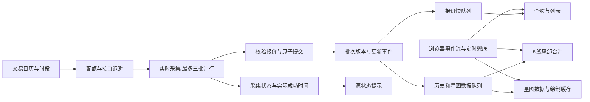

# 数据刷新架构审查与修正 · 2026-10-28

## 结论与实际数据源状态

问题同时存在于采集、数据库读取、界面调度和绘制。仅缩短轮询间隔无法解决。已修复本地刷新链路并增加状态诊断；仍需满足实时源授权和交易时段条件。

只读查询用户运行实例时，采集已开启且 Token 已配置，但服务报告 `rt_k` 权限不可用并进入退避。该状态可直接导致交易期间没有新行情。Tushare 的 [A 股实时日线接口](https://tushare.pro/document/1?doc_id=372) 要求独立授权；[当日分钟数据](https://tushare.pro/document/2?doc_id=457) 和 [实时分钟接口](https://tushare.pro/document/2?doc_id=374) 也有各自权限要求。代码不能授予供应商账号权限，未提交付费或开通操作。

## 分层原因与修正

| 层级 | 原问题 | 修正后的约束 |
| --- | --- | --- |
| 采集 | 日历长超时，权限失败反复重试，配置变更不能及时打断等待 | 日历使用 8 秒实时超时；共享配额、接口独立退避；配置变更约 1 秒唤醒；日历不可用时仅以真实当日报价验证会话 |
| 状态 | 历史成功与实时成功混淆 | 独立记录 rt_k 成功/尝试时间、耗时、连续失败与原因；区分交易会话与源可用性 |
| 提交 | 跨批次读取混用风险 | 全市场批次原子提交；报价、日线和版本使用同一 SQLite 读取快照 |
| 桌面 | 单队列混排历史/网络与报价；反复作废慢响应；固定个股不更新 | 三条有界队列；合并同类后台读取；主动切换仍作废旧选择；完成唤醒重绘；独立更新固定股票 |
| 浏览器 | 相同读取相互取消；事件不断推迟刷新；行情页缺少定时兜底 | 相同 URL 共享 Promise，新选择取消旧读取；400ms 事件合并不无限延后；补充行情页兜底 |
| K 线 | 每轮读取完整历史；慢历史回滚新报价 | 先显示报价再更新尾部；替换当前日/周/月周期；保留历史和六条均线预热；时间与版本保护 |
| 统计 | 健康检查和列表频繁扫描全库历史 | 历史总数缓存 30 秒、导入失效；最新报价时间始终现查；显式统计仍重算 |
| 星图 | 无变更也重算数千文字、颜色与几何 | 数据按报价版本/设置/查询/交易日期失效，最长 30 秒；绘制按数据/视口/搜索/缩放/配色失效；鼠标移动复用几何和标签；浏览器使用静态画布缓存，浮动提示更新也合并到每帧 |

## 刷新语义

原生端接收本进程提交事件，活跃页面 500ms 心跳检查事件，工作结果主动唤醒重绘。报价有 15 秒数据库读取兜底，星图 30 秒兜底，用于跨进程更新或丢失事件；尾部历史更新最多每 5 秒调度。浏览器通过事件流及 5 秒页面兜底触发读取。这些是界面读取间隔，不是数据源延迟承诺。

采集使用实际配额适配后的间隔，计入上一轮网络及写入耗时，不重叠追赶。权限和限流退避优先于周期；错误期间保留缓存及真实报价日期，不以当前时间冒充数据时间。

日/周/月尾部分别取最后一根所在日、周一、月初。周/月 bar 日期会随最后交易日改变，因此替换整个当前周期，不能按日期直接追加。均线保留此前日线预热；历史不足仍为空值。导入和历史任务完成触发完整读取。

## 验证证据与边界

- 141 项常规 Rust 测试通过：包括慢请求隔离、合并、固定股票更新、旧响应保护、并发快照版本、日周月尾部与完整重载及六条均线相等。
- 40 项 Web 测试通过：包括 100 个重复慢读取只发一次、选择切换、事件突发、无事件流兜底、报价先于历史显示。
- 严格 Clippy 通过。增量缓存硬链接提示属于构建环境提示。
- 6000 股、8 轮、共 48000 次行情接受写入；170 次并发读取保持批次一致。单轮写入 2349–2819ms，为本机未优化测试构建及独立数据库结果，不是供应商吞吐承诺。
- 6000 股原生 egui 布局及 tessellation CPU 审查：强制重建中位 31.291ms，缓存后中位 15.882ms、P95 21.022ms。包含 headless 布局及网格生成，不包含 GPU、窗口呈现或系统合成，不能据此宣称实机帧率。
- 浏览器 5572 股、1920×1080、DPR 1.5：静态缓存后 60 次绘制调用的 JavaScript 提交耗时 P95 为 0.2ms（此前 122.7ms）；120 次指针事件合并一次绘制，事件处理总耗时 22.5ms（此前 356.8ms）。慢响应 750ms、30 次同类读取合并为一次、故障保留画布/恢复、连续 12 个版本推进均通过。测试与发布编译并行执行，耗时受系统负载影响；缓存调用主要提交图像复制命令，未测量 GPU 完成和呈现，不能解释为实际帧率。记录位于 `target/refresh-audit-20261028/browser-cached.json`。
- 日历超时和权限/限流使用本地夹具验证，不消耗实际行情接口额度。
- 原生独立测试程序：通过本机 API 注入模拟报价和当日 K 线，确认个股价格从 1335 自动变为 1336、历史增加当日 bar；切至星图后再次注入 1338，涨幅从 1.33% 自动变为 1.48%，均未点击刷新。测试配置禁用供应商采集，不含 Token，用户数据库未改动。实机检查发现的星图页全局行情时间未推进也已修正，并由桌面回归覆盖。
- 模拟截图：`dist/REFRESH-0.2.10-stock-synthetic.png`、`dist/REFRESH-0.2.10-map-synthetic.png`。测试星图仅包含同日有效的一个模拟报价，不代表全市场实盘覆盖。

日志位于 `target/refresh-*-20261028.log`，原生测量位于 `target/refresh-audit-20261028/native-canvas.json`。构建目录文件被忽略，本文保留结果和测量口径。

测试发生在夜间，尚未完成开盘、午休、收盘全过程观察。盘中需检查实时成功时间、当日报价、星图版本持续推进，以及个股与当前周期 K 线一致。实际 rt_k 授权未解决前不能将缓存画面视为实时行情。
